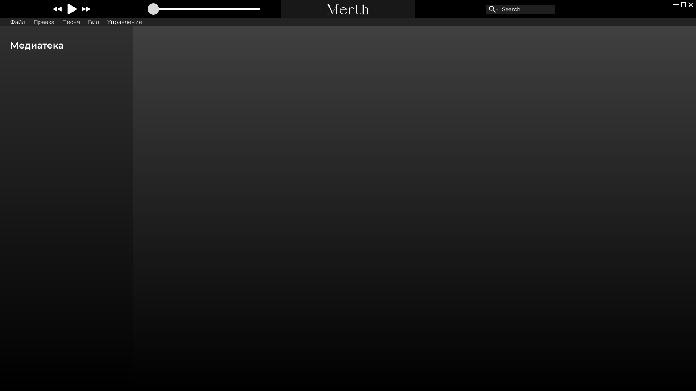

# Spotivar :: Biblioteca/reproductor/almacén de música en desarrollo (WIP) 

Estamos creando algo similar a **Spotify**, pero un poco más abierto, dirigido a nerds y, en cierta manera, más funcional. ¡Esperamos que te guste!

**Aún está muy en sus inicios de desarrollo, así que no esperes que nada funcione ni que lo uses en estas condiciones, está muy lejos de estar listo. ¡Pero eres bienvenido a ayudar!**

## Visuales en desarrollo (WIP)

Diseño deseado, pero aún no implementado:



## Requisitos previos

Necesitas tener instalados `CMake`, `Ninja` y `Clang`. Puedes instalarlos con el gestor de paquetes de tu distribución.

Por ejemplo, en **Arch Linux** puedes ejecutar:
```sh
sudo pacman -Sy cmake clang
```

Y para **Ubuntu:** 
```sh
sudo apt-get install -y cmake clang ninja-build
```

Luego, necesitas instalar 4 bibliotecas de las cuales este proyecto depende en gran medida: `GTKmm3.0`, `Boost`, `Flac` y `Ogg`. Puedes compilarlas todas desde el código fuente (es lo que definitivamente recomendaría para las dos últimas, ya que su distribución a través del gestor de paquetes generalmente no incluye los archivos necesarios para que `CMake` pueda encontrarlas). `Boost`, por su parte, suele poder instalarse perfectamente con un gestor de paquetes:

Por ejemplo, en **Arch Linux**:
```sh
sudo pacman -Sy boost boost-libs ninja gtkmm3
```

En **Ubuntu**:
```sh
sudo apt-get install -y libboost-all-dev libgtkmm-3.0-dev
```

Compilar `Ogg` y `Flac` desde el código fuente también es bastante sencillo: selecciona el directorio donde quieres instalarlos y ejecuta `cd` para ir allí; este directorio puede estar en cualquier parte de tu sistema, por ejemplo, en `/opt/` (ten en cuenta que este directorio suele pertenecer a `root`, necesitarás clonar con `sudo` y luego cambiar el propietario del repositorio clonado a tu usuario con: `sudo chown -R <your-user-name>:<your-usuall-group-usually-has-same-name-as-user> <dir>`).

Una vez hecho esto, puedes descargar y compilar `Ogg` (debe compilarse primero, ya que `Flac` depende de él):
```sh
git clone https://github.com/xiph/ogg.git && cd ogg
cmake -B build .
cmake --build build
sudo cmake --build build --target install
```

Y luego haz prácticamente lo mismo para `Flac`:
```sh
git clone https://github.com/xiph/flac.git && cd flac
cmake -B build .

# Por alguna razón las manpages no se compilan, así que las desactivé:
cmake --build build -DINSTALL_MANPAGES=OFF 
sudo cmake --build build --target install
```

## Compilación

Luego, lo compilas como cualquier otro proyecto de CMake, desde la raíz del proyecto ejecuta:
```sh
# Cuidado, usa algunas extensiones de Clang para C++, ¡así que no se compilará con GCC!
cmake -B build -DCMAKE_CXX_COMPILER=clang++ -DCMAKE_BUILD_TYPE=Release
cmake --build build --config Release
```

¡Ahora puedes ejecutar el ejecutable del proyecto: `./build/src/spotivar`!
